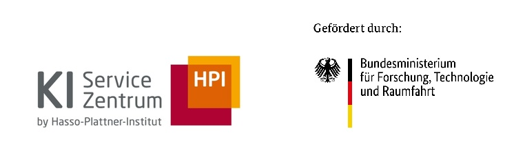
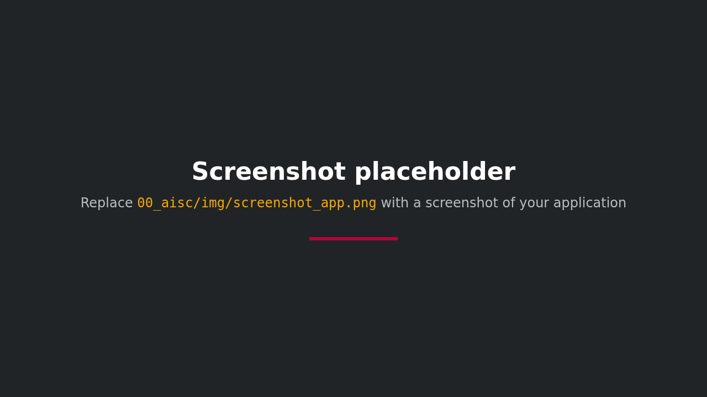

<div style="background-color: #ffffff; color: #000000; padding: 10px;">

<h1> AI Project Template
</div>

A lightweight, modern Python project template used by the **AI Service Center Berlin-Brandenburg (HPI)** for AI project repositories.



Replace `assets/screenshot_app.png` with a screenshot. Keep the image under the description so it is the first thing a visitor sees after the title; a 1280 by 720 PNG renders well on GitHub.

 and provides a clean, standardized starting point for AI projects by the [AI Service Center Berlin-Brandenburg](https://github.com/aihpi).

## Creating a New Project

Use **uvinit** with the AI HPI template:

```bash
uvx uvinit --template gh:aihpi/template-ai-project
```

Then, just follow the instructions.

## What is this?

This repository provides a **standardized AI project scaffold** designed specifically for AI and research-oriented development at **AI Service Center Berlin-Brandenburg (HPI)**.

The goal is to give AI@HPI teams a **consistent, maintainable, and modern baseline** for building AI Python applications, prototypes, research code, and AI-related utilities, without unnecessary complexity.

The template is based on the excellent [simple-modern-uv](https://github.com/jlevy/simple-modern-uv) template by [jlevy](https://github.com/jlevy).

## What this template includes

The template offers:

- **uv** for fast dependency management, virtual environments, packaging, and builds  
- **Automatic versioning** derived from Git tags, removing the need for manual version bumps.
- **ruff** for linting and code formatting
- **BasedPyright** for static type checking  
- **pytest** with **pytest-sugar** for testing
- **codespell** for spell checking
- Preconfigured **GitHub Actions** workflows:
  - Continuous Integration (lint + type check + tests)
  - Package building and optional publish-to-PyPI workflow
- Generated projects include modular, editable docs:
  - `installation.md` – how to set up and install dependencies  
  - `development.md` – development workflows (tests, linting, formatting, etc.)  
  - `publishing.md` – how to publish releases (if relevant)

## Blueprint capture

Every generated project carries a `casebook.yaml` that names the AI service blueprints the project feeds (see [aihpi/template-blueprint](https://github.com/aihpi/template-blueprint)), a `CLAUDE.md` that tells Claude Code to write insights into the local clone of `blueprint-<slug>/casebook/` only through the casebook skills of the kisz marketplace and only after confirmation, and a `PreCompact` hook in `.claude/settings.json` that scans the session before the context is compacted. The kick-off guide in `.claude/guides/kickoff.md` explains how to fill `casebook.yaml`. The casebook skills are not yet available; the hook is a stub until then.

## What this template doesn't include

This template doesn't include:

- Domain-specific AI frameworks or dependencies (e.g., PyTorch, TensorFlow, Hugging Face)  
- Data pipelines or preprocessing scripts  
- Complex deployment tooling (Docker, Kubernetes, cloud CI/CD)  
- Detailed documentation templates beyond basic `installation.md`, `development.md`, and `publishing.md`  
- Advanced project organization for very large repositories (e.g., multi-package monorepos)

## What do we want to add to this template

For improving the template and further streamline AI HPI projects, we are considering possible enhancements including:

- Optional integration with **ML/DL frameworks** (PyTorch, TensorFlow) and environment configurations for GPU support  
- Prebuilt **data handling and preprocessing utilities** for common AI workflows  
- Template **notebooks or example scripts** for standard tasks such as model training, evaluation, and visualization  
- Optional **Dockerfile and cloud deployment templates** for easier productionization  
- A **standardized logging and experiment tracking setup** (e.g., with MLflow or Weights & Biases)  
- Extended **documentation templates** for research papers, reproducibility, and project reporting
- Template **type stubs and mypy integration** for stricter type checking in AI-heavy projects

## About AI HPI / KI-Servicezentrum

The AI Service Center Berlin-Brandenburg (HPI) supports organizations in adopting state-of-the-art AI through research, compute resources, consulting, and educational offerings.
More information: https://hpi.de/ki-servicezentrum/